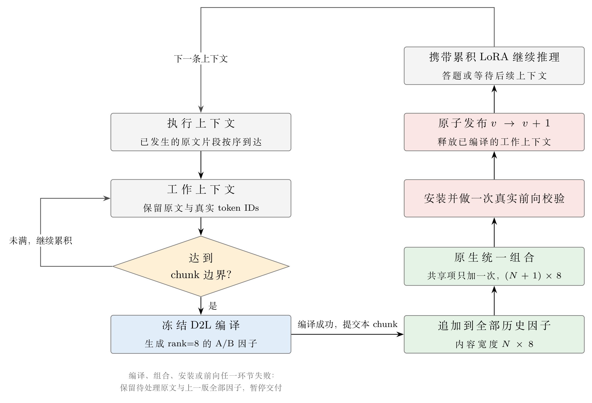

# Memory-to-LoRA

把执行过程中产生的连续上下文，按 chunk 直接编译成 LoRA 参数因子并持续累积；后续推理携带
这些因子，不再把已编译原文拼回输入。不摘要、不改写、不做记忆选择或替换。

当前为 **v0.1**：只建立这条最小的「直接 D2L」链路，记忆效果留待真实评测。



图片由 [docs/figures/pipeline.tex](docs/figures/pipeline.tex) 用 TikZ 绘制。

## 主链路

1. **累积**：原文按到达顺序进入工作上下文，原文与真实 token IDs 分别保留。
2. **切块**：达到 `memory.chunk_tokens`（含聊天模板与特殊 token），或再加入下一片就会超限时，
   取当前完整片段作为一个 chunk。不足一个 chunk 时继续累积，不为填满而截断原文。
3. **编译**：完整 chunk 交给冻结的 D2L 编译器，生成一组 rank=8 的 A/B 内容因子。
   rank、层数、模块维度和 scale 一律从实际 checkpoint 读取。
4. **追加**：新因子追加到全部历史因子，历史 chunk 的原文副本保留在编译记录中用于复现。
5. **组合**：全部原始块按历史顺序一次性交给原生 `combine_lora`，共享项只加入一次。
6. **安装与校验**：安装组合后的 LoRA，并做一次真实前向；全部成功才原子发布 `v → v+1`，
   同时释放已编译的工作上下文。
7. **推理**：任务输入只包含任务规则、**尚未编译**的上下文和当前问题。
   已编译原文不回灌，也不读取其它题目的答案。

任一环节失败：保留待处理原文与上一版全部因子，历史交付暂停，不推进游标。

## 关键约定

| 约定 | 说明 |
| --- | --- |
| 因子宽度 | 内容宽度 `N × 8`，加入共享项后分配宽度 `(N + 1) × 8`，`N` 为已提交 chunk 数 |
| 空历史 | 没有内容因子也没有共享项，直接使用纯基座 |
| 历史收尾 | 剩余不足一个 chunk 的尾段也编译一次，全部提交后才允许 `freeze` |
| 容量 | 因子随历史单调增长，没有固定槽位、淘汰或压缩预算 |
| 宽度含义 | 这是 A/B 的分配维度，不等于数学矩阵秩，也不能换算成可记住的事实条数 |

## 仓库结构

| 路径 | 用途 |
| --- | --- |
| [Main-Code/src/param_memory/](Main-Code/src/param_memory/) | 运行时、D2L 后端、事件分片、状态契约、评测外壳 |
| Main-Code/configs/ | 唯一配置入口，`schema_version: 2` |
| Main-Code/prompts/ | 任务提示模板 |
| Main-Code/experiment/ | 100 题主实验与两条基线的 SLURM 脚本 |
| [docs/](docs/README.md) | 方法方案、高层设计、选型与实现记录 |
| scripts/、tools/ | 环境准备、冒烟测试、基线脚本 |
| [AGENTS.md](AGENTS.md) | 项目工作规则 |

以下内容只保留本地、不进入版本库：`resources/`（模型、checkpoint、数据集、doc-to-lora）、
`research/` 下的来源与实验原始记录、`Main-Code/tests/`、`result/` 运行结果、`.venv*/` 与 `wheels/`。

## 快速开始

需要 Python 3.10 及 [requirements-d2l.txt](requirements-d2l.txt) 对应的环境（PyTorch 2.6.0 / CUDA 12.4、
Transformers 4.51.3、PEFT 0.17.1），真实编译与推理还需要已分配的 CUDA 设备。

```bash
cd Main-Code
python -m pip install -e '.[dev]'
python -m param_memory validate-config --config configs/mab_sh6k.yaml   # 只校验 YAML 与本地资源
python -m param_memory run-mab --config configs/mab_sh6k.yaml           # 需要 GPU
```

新环境可从 `configs/mab_sh6k.example.yaml` 复制一份再改；配置内路径统一相对该 YAML 所在目录解析。

## 配置要点

```yaml
schema_version: 2
memory:
  chunk_tokens: 2048        # 单个 chunk 上限，含 D2L 模板与特殊 token
generation:
  task:
    max_input_tokens: 16384 # 任务规则 + 未编译上下文 + 问题
    max_new_tokens: 512
prompts:
  task_path: ../prompts/task.md
```

`memory` 只有 `chunk_tokens` 一个字段；旧的槽位、队列、管理器相关字段会被严格拒绝。
`mab_sh6k_budget512_baseline.yaml` 是 `chunk_tokens: 512` 的对照配置。

## 日志与产物

日志写入 YAML 的 `logging.directory/<run_id>/`：

| 文件 | 内容 |
| --- | --- |
| `run.log` | 各阶段（编译、组合、安装、前向、答题、评分）与耗时、异常 |
| `resolved_config.yaml` | 启动时的完整配置 |
| `maintenance.jsonl` | 每个 chunk 的提交版本、结果、错误与真实成本 |
| `predictions.jsonl` | 逐题回答、分数、版本与错误 |

结果写入 `output.directory/<run_id>/`：`metrics.json`（官方分数、失败分母、成本、chunk 数与占用）、
`manifest.json`（代码/模型/数据/提示指纹与完整编译输入）、`final_snapshot.json`、
`memory.safetensors`（全部原始 A/B 与组合后的 A/B）。

## 验证状态

2026-10-30 的本地检查：单元测试 78 passed、`ruff check src tests` 通过、三个 YAML 的
`validate-config` 通过、`build --no-isolation` 成功。真实 checkpoint 的集成测试因当前进程没有
CUDA 而 skipped，**尚未完成真实模型的编译与 SH6K 问答评测**，不能据此声称记忆效果已提升。
详见 [实现说明](docs/IMPLEMENTATION.md)。

## 文档

- [直接 D2L 方法与边界](docs/DIRECT_D2L_FLOW.md)
- [高层设计与接口契约](docs/HIGH_LEVEL_DESIGN.md)
- [实现与检查记录](docs/IMPLEMENTATION.md)
- [Benchmark 选型](docs/BENCHMARK_SURVEY.md) · [MAB 数据说明](docs/MAB_DATA_GUIDE.md)
- 运行时细节见 [Main-Code/README.md](Main-Code/README.md)
