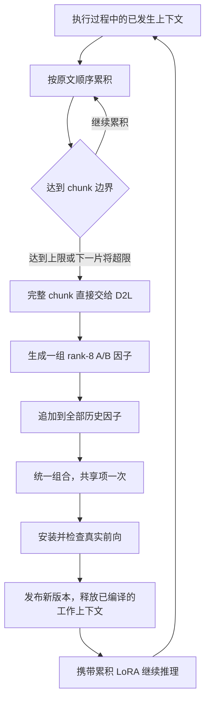

# 直接 D2L 参数记忆

更新：2026-10-30（Asia/Shanghai）。当前阶段只搭建执行过程中直接应用 D2L 的最小链路。

连续上下文达到一个 chunk 时，直接交给冻结的 D2L 编译器，生成 rank=8 的 LoRA 内容因子，
随后与全部已提交因子一起安装，用于后续推理。每个 chunk 保留完整原文，既有因子持续累积。
当前代码已移除全局记忆槽、局部队列、替换策略、事实改写和管理模型调用。

## 执行流程



`memory.chunk_tokens` 是实际 D2L 输入的上限，包含聊天模板与特殊 token。
原文按 Unicode 字符边界无损分片，并检查真实 tokenizer 长度；可容纳时优先保留完整句子。
chunk 由连续的完整来源片段组成，因此某块可能略小于上限。不会为了填满而截断或丢弃后缀。
历史结束时，剩余不足一个 chunk 的内容也编译一次；空历史使用纯基座。

来源原文与真实 token IDs 分别保存。编码复用原生 `tokenize_ctx_text`，该函数会去掉每个 chunk
首尾的空白，再应用聊天模板；编译记录中的原文不变。仅含空白的非空片段也能编译，
因此分片后的换行或空格尾段不会导致链路中断。

只有编译、组合、安装和前向检查全部成功后，才推进原文游标并发布新版本。
失败时保留待处理原文与上一版全部因子，停止继续交付历史。日志立即记录已完成的 chunk。

## rank 与因子组合

当前 checkpoint 的原生 rank 为 8。运行时从实际 checkpoint 读取 rank、模块维度和 scale，
不修改 hypernetwork 结构，不把 A/B 误写为实际的 8×8 方阵。每个目标模块的原始 A/B 布局为：

```text
A: [1, layers, 8, d_in]
B: [1, layers, 8, d_out]
```

| 历史 chunk 数 | 内容宽度 | 加一次共享项后的分配宽度 |
| --- | --- | --- |
| 1 | 8 | 16 |
| 8 | 64 | 72 |
| 9 | 72 | 80 |

所有原始块按历史顺序一次性交给原生 `combine_lora`；共享项始终只加入一次。
不会分别组合每块后再次相加，也不会按新增总宽度重新缩放原生 LoRA。

## 当前边界

全部历史 chunk 的因子参与推理，参数占用随历史增长。原文和输入指纹保留在编译记录中用于复现，
任务 prompt 只接收任务规则、尚未编译的上下文和当前问题；已编译原文不回灌到推理输入。
移除选择和替换环节可以消除这两个环节的丢弃，但 D2L 自身的压缩与读出仍需真实评测。
本轮不增加其它记忆机制，也不据此宣称事实记忆效果已经提高。

代码与接口见 [高层设计](HIGH_LEVEL_DESIGN.md)，运行和验证见 [实现说明](IMPLEMENTATION.md)。
